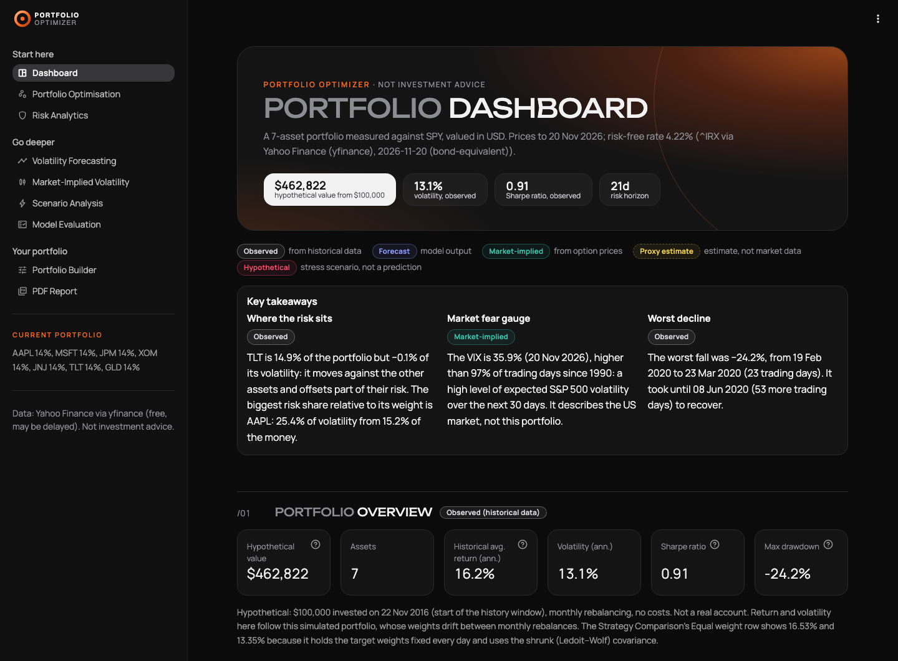
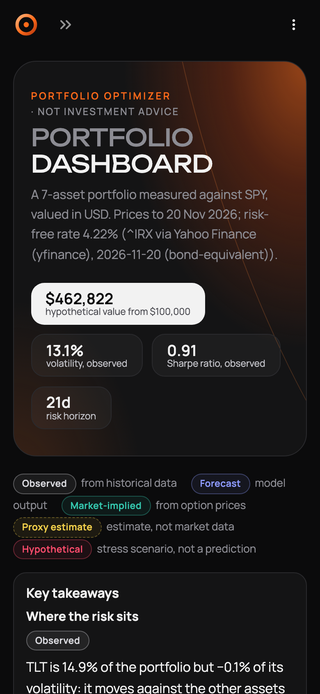

# Portfolio Optimizer



Portfolio Optimizer is a Streamlit app that takes a portfolio of stocks, bonds or funds, shows how it
has behaved, and asks how risky it is likely to be over the next month. It compares optimised
portfolios (equal weight, minimum variance, maximum Sharpe, custom constraints), measures risk
(VaR and CVaR, drawdowns, each asset's share of risk, stress scenarios), forecasts volatility with
historical, GARCH(1,1) and LSTM models that are tested on a locked out-of-sample window, compares
those forecasts with what option prices imply, and writes a PDF risk report. Every number is labelled
as **observed**, **forecast**, **market-implied**, **proxy estimate** or **hypothetical**, missing
data is never filled in, and model results are reported as they come out, including where the LSTM
does not beat GARCH.



> Not investment advice. Free data may be delayed or revised.

**Contents:** [Run it locally](#run-it-locally) · [Data sources](#data-sources) ·
[Precomputed forecasts](#precomputed-forecasts) · [Results](#results) · [Hosting](#hosting) ·
[What the app does](#what-the-app-does) · [Plain-English guide](#the-ideas-behind-it-in-plain-english) ·
[Limitations](#limitations) · [Tests](#tests)

---

## Run it locally

Requires **Python 3.11+** (developed and tested on 3.12, macOS).

```bash
git clone https://github.com/ooLLeeGG08/Portfolio-Optimiser-with-Market-Implied-Risk.git
cd Portfolio-Optimiser-with-Market-Implied-Risk
python3.12 -m venv .venv
.venv/bin/pip install -r requirements.txt
.venv/bin/streamlit run app.py
```

Open http://localhost:8501. No API keys or accounts are needed.

The default portfolio is AAPL, MSFT, JPM, XOM, JNJ, TLT and GLD, equally weighted, against SPY. Change
it on the **Portfolio Builder** page (weights or dollar amounts, benchmark, horizon, risk-free rate,
rebalancing, history length).

**How long things take**

| What | Time | Notes |
|---|---|---|
| Market data | seconds | Cached on disk for 12 hours (`.cache/`) |
| Volatility forecasts, default portfolio | instant | Loaded from the [precomputed files](#precomputed-forecasts) |
| Volatility forecasts, any other portfolio | about 20 s per asset (≈ 3 minutes for 7) | One GARCH and one LSTM per asset plus the portfolio; a progress bar shows each asset. The estimate shown in the app comes from `FORECAST_SECONDS_PER_SERIES` in `config.py` |
| Option chains | about 25 s | Downloaded live when the Market-Implied page opens |

Results are reused for the rest of the day.

---

## Data sources

All market data comes from **Yahoo Finance through [yfinance](https://github.com/ranaroussi/yfinance)**,
an **unofficial**, community-maintained library that reads Yahoo's public web endpoints. It is not
affiliated with or supported by Yahoo. In practice that means:

- data can be **delayed**, **revised** (adjusted histories change after splits and dividends) or
  briefly **unavailable**;
- Yahoo can **rate-limit** requests, especially from cloud servers; the app reports the failure
  instead of showing stale or invented numbers;
- a change on Yahoo's side can break downloads until yfinance is updated.

| Data | Ticker(s) | Used for |
|---|---|---|
| Daily adjusted closes | the portfolio's tickers and the benchmark | Returns, risk, optimisation, forecasts |
| VIX | `^VIX` | S&P 500 implied volatility, proxy estimates |
| 13-week T-bill yield | `^IRX` | Risk-free rate (unless set manually) |
| 10-year Treasury yield | `^TNX` | Interest-rate sensitivity |
| Exchange rates | e.g. `USDJPY=X` | Converting foreign listings to USD |
| Option chains | each asset | Option-implied volatility (a current snapshot) |

An unfinished trading day is excluded, assets are aligned on shared dates without filling gaps, and
an asset with data problems is excluded with a message. The `MarketDataProvider` interface in
`data/market_data.py` lets another vendor be plugged in.

---

## Precomputed forecasts

Fitting GARCH and training an LSTM for every asset takes minutes, too long for a first visit. So
the **default portfolio's** forecasts are computed ahead of time and stored in the repository.

- **What is stored** (`precomputed/default/`, about 0.5 MB): the latest forecasts with 10–90%
  intervals, the full out-of-sample (walk-forward) evaluation, Diebold–Mariano tests, GARCH
  diagnostics and the LSTM training summary for all 7 assets and the portfolio. `meta.json` records
  when the run was made, the last price date, the exact settings and the code version.
- **How**: `python scripts/precompute_forecasts.py` runs exactly the same code as the app's
  **Run volatility forecasts** button. Optional environment variables: `PI_PRECOMPUTED_DIR` (output
  folder) and `PI_CACHE_DIR` (price cache). No secrets are involved; yfinance needs no key. If the
  portfolio itself or more than half of the assets fail, the script exits with an error and keeps the
  previous files.
- **When**: the GitHub Actions workflow
  [`refresh-forecasts.yml`](.github/workflows/refresh-forecasts.yml) runs **Monday to Friday at
  22:30 UTC**, after the New York close. It installs the same pinned packages as the hosted app, runs
  the script and commits the refreshed files with the workflow's own token, and that commit triggers
  a redeploy. It can also be started by hand from the **Actions** tab (**Run workflow**).
- **In the app**: the files are used only when the current settings match the default portfolio.
  Every page that uses them says **"Precomputed on [date] (prices to [date])"**, and the label turns
  into a warning if the files are more than 4 days old. Any other portfolio uses the **Run volatility
  forecasts** button. The default portfolio can be recomputed with today's data from **Recompute
  with today's data**. A run cut off by a dropped connection continues by itself, keeping finished
  assets.

---

## Results

Figures from the run on prices to **20 Nov 2026**. They change as new data arrives; the app always
shows the current numbers.

### Strategy backtest (locked test window, 18 Nov 2024 – 20 Nov 2026)

Monthly walk-forward rebalancing; weights estimated from the previous 252 trading days only; 10 bps
cost on traded notional. The test window was not used to choose any setting.

| Strategy | CAGR | Volatility | Sharpe | Max drawdown | Turnover (per year, one-way) |
|---|---|---|---|---|---|
| Equal weight | 18.4% | 11.5% | 1.16 | −11.1% | 27% |
| Minimum variance | 16.4% | 9.5% | 1.20 | −7.6% | 48% |
| Maximum Sharpe | 27.1% | 15.5% | 1.36 | −11.8% | 126% |

Two years is one market regime, and these differences are not tested for significance. Read them as
a description of that period, not as evidence that one strategy is better.

### Volatility forecasts (locked test window, 18 Oct 2024 – 22 Oct 2026)

Each model forecasts annualised realised volatility over the next 21 trading days. QLIKE is the loss
function most robust to noise in realised volatility (lower is better). The p-value is the
Diebold–Mariano test of LSTM against GARCH (HAC variance, small-sample correction).

| Series | Historical 60d | GARCH(1,1) | LSTM | Lowest QLIKE | LSTM vs GARCH p-value |
|---|---|---|---|---|---|
| AAPL | 0.492 | **0.319** | 0.364 | GARCH | 0.42 |
| MSFT | 0.420 | **0.367** | 0.405 | GARCH | 0.42 |
| JPM | 0.348 | **0.254** | 0.293 | GARCH | 0.61 |
| XOM | 0.189 | **0.153** | 0.203 | GARCH | 0.09 |
| JNJ | **0.258** | 0.286 | 0.438 | Historical 60d | **0.004** (GARCH better) |
| TLT | 0.093 | 0.099 | **0.087** | LSTM | 0.29 |
| GLD | 0.460 | 0.396 | **0.368** | LSTM | 0.30 |
| Portfolio | 0.510 | **0.367** | 0.411 | GARCH | 0.47 |

- GARCH had the lowest loss for 5 of 8 series, the LSTM for 2 and 60-day historical volatility for 1.
- The LSTM–GARCH difference is statistically significant (5%) for **one** series, JNJ, where GARCH was
  better. For the other seven the data cannot tell them apart: 504 daily forecasts contain only about
  24 independent 21-day outcomes.
- The 10–90% intervals should contain the outcome 80% of the time. GARCH intervals covered 68–87%;
  LSTM intervals covered 57–80%, so they were **too narrow** in this period.

Full tables, including MAE, RMSE, bias, directional accuracy and the non-overlapping subsample, are on
the **Model Evaluation** page and in the PDF report.

---

## Hosting

The app runs as a container on **Vercel** (`Dockerfile.vercel`, Linux, CPU-only PyTorch from
`requirements-vercel.txt`). Vercel detects the file and redeploys on every push to `main`, including
the daily forecast refresh. No environment variables or keys are needed.

**Deploy:** on vercel.com choose **Add New → Project**, import the repository, keep the framework
preset **Other**, and deploy. Or run `vercel deploy --prod` from the project folder.

**Test the same image locally (optional):**
```bash
docker build --platform linux/amd64 -f Dockerfile.vercel -t portfolio-optimizer .
docker run --rm -p 8080:80 portfolio-optimizer    # open http://localhost:8080
```

Vercel runs containers as short-lived functions, while Streamlit expects one long-lived server with
an open connection per visitor. The app works around the differences:

| Vercel behaviour | Effect | How the app handles it |
|---|---|---|
| A connection lasts at most 5 minutes (Hobby) | Long runs can be cut off | A run records itself in the page URL and continues by itself after the reconnect; finished assets are kept |
| Idle servers shut down after about 5 minutes | The first visit after a quiet spell starts slowly | Default-portfolio forecasts come from the precomputed files, so nothing long has to run |
| Servers do not share memory | One visitor's results do not help the next | The portfolio is stored in the URL (also a shareable link); the PDF is embedded in the page so its download never needs a second server |
| 2 GB memory | The full analysis peaks at about 0.9 GB | Fits |

Streamlit Community Cloud (one persistent server, free) would avoid the connection limits but has a
small memory allowance that PyTorch makes tight. Hugging Face Spaces can run the same Docker image with
more memory. Hosting has not been changed.

---

## What the app does

| Section | Contents |
|---|---|
| **Dashboard** | Key takeaways in plain English; hypothetical portfolio value, historical average return, volatility, Sharpe, drawdown; VaR/CVaR; risk contributions; historical vs GARCH vs LSTM vs implied volatility |
| **Portfolio Builder** | Search by company, fund or ticker (e.g. "Toyota" → `7203.T`); weights or dollar amounts; ticker check; inputs and validation, data-quality report, composition (target vs drifted weights), performance vs benchmark, daily/monthly return statistics, correlation matrix, data provenance |
| **Portfolio Optimisation** | Equal weight, minimum variance, maximum Sharpe, custom constraints (min/max weight, target return or volatility), your own weights; efficient frontier; sensitivity of max-Sharpe weights to estimation error |
| **Volatility Forecasting** | Rolling 20/60/252-day volatility; GARCH(1,1) and LSTM forecasts with 10–90% intervals; out-of-sample forecast chart; GARCH diagnostics; LSTM training details |
| **Market-Implied Volatility** | VIX level, history, percentile and variance risk premium; option-chain implied volatility per asset (term structure, smile, filtered quotes); implied vs forecast comparison; Volatility Disagreement Indicator |
| **Risk Analytics** | Volatility, Sharpe, Sortino, beta, max drawdown; historical, parametric, Cornish–Fisher and Monte Carlo VaR/CVaR; Euler risk contributions; forward-looking risk from historical, GARCH, LSTM or implied volatility (Σ = D·R·D) with correlation stress |
| **Scenario Analysis** | Market −10%/−20%, +100 bp rates, volatility ×1.5, correlation convergence, single-asset shock, and a custom scenario builder — all labelled hypothetical |
| **Model Evaluation** | Walk-forward strategy backtest with costs and turnover (development vs locked test window); out-of-sample accuracy of every volatility model with Diebold–Mariano tests |
| **PDF Report** | 15-section research report generated from the current results |

### Volatility Disagreement Indicator

For each asset, the indicator measures how far historical, GARCH, LSTM and implied (or proxy)
volatility disagree at the same horizon: the standard deviation of their logarithms, with bands fixed
in advance (Low < 0.10 ≤ Moderate < 0.25 ≤ High). It is an analytical comparison, **not a trading
signal** — disagreement reflects different information and assumptions, not mispricing.

### PDF risk report

Generated from the PDF Report page. Sections: executive summary; portfolio composition; performance;
optimisation results; efficient frontier; historical risk metrics; VaR and CVaR; asset risk
contributions; volatility forecast comparison; market-implied volatility; stress tests; model
evaluation; methodology and assumptions; **model limitations and data quality**; data limitations and
disclaimers. The cover lists the generation time and every data observation date.

---

## The ideas behind it, in plain English

No finance or maths background needed. Each part below explains one idea the app uses, with an
everyday comparison. Example numbers come from the default portfolio (Apple, Microsoft, JPMorgan,
Exxon, Johnson & Johnson, a US government bond fund and a gold fund, equal amounts in each) at the
time of writing, November 2026. Your numbers will differ.

### 1. How has the portfolio done, and how bumpy was the ride?

- **Return** is how much the value changed. $100 that becomes $110 is a 10% return.
- **Volatility** measures how much the value jumps around from day to day. A savings account has almost
  none; a single tech stock has a lot. Two investments can end up with the same return, but the one
  that swung wildly on the way was riskier to hold. The app turns daily swings into a yearly figure.
  It multiplies by √252, not 252 (there are about 252 trading days in a year), because random ups and
  downs partly cancel out over time.
- **Sharpe ratio** is reward per unit of bumpiness: the return above what a risk-free government
  bill pays, divided by volatility. Higher is better. The default portfolio's is about 0.9.
- **Maximum drawdown** is the worst fall from a high point to the low that followed. For the default
  portfolio it was about −24%, in the COVID crash of early 2020.
- **Beta** says how strongly the portfolio follows the stock market. A beta of 0.64 means that when
  the market falls 10%, this portfolio has typically fallen about 6.4%.
- **Foreign shares** (Toyota in yen, for example) are converted into dollars every day, so currency
  swings count as part of the risk, just as they would for a US investor who owns them.

### 2. Choosing the mix (portfolio optimisation)

- **Diversification** is "don't put all your eggs in one basket", with a twist: what matters is how
  the baskets move *together*. Government bonds often rise when stocks fall, so holding both makes
  the whole portfolio calmer than either part.
- **Correlation** measures that togetherness, from +1 (always move together) to −1 (always opposite).
- The **optimiser** tries many mixes and finds:
  - the **minimum-variance** mix, the calmest one possible;
  - the **maximum-Sharpe** mix, the most return for each unit of bumpiness.
- The **efficient frontier** is the curve of best possible mixes: for each level of risk, the highest
  return. Any mix below the curve could be improved.
- **The big caveat:** the optimiser trusts past average returns, and those are very unreliable. It's
  like judging a basketball player from ten games. The app reshuffles its return estimates within
  their margin of error 200 times, and the "best" weights swing wildly, so treat optimal weights as
  a rough guide, not an answer. It also applies **shrinkage**, which tones down extreme estimates so
  the optimiser doesn't overreact to noise.

### 3. How bad could a bad day be? (VaR, CVaR and risk contribution)

- **Value at Risk (VaR)** answers: "On a bad day, how much could I lose?" A 1-day 99% VaR of 2.27%
  means: on roughly 1 day in 100, expect to lose more than 2.27% of the portfolio (about $10,600 on
  $468,000). It is a threshold, not the worst case.
- **CVaR (Expected Shortfall)** answers the follow-up question: "When those 1-in-100 days happen, how
  much do I lose on average?" Here about 3.37%. Many risk managers prefer it because it looks at the
  whole tail, not just its edge.
- The app estimates both in four ways:
  - replaying actual history;
  - assuming a smooth bell curve;
  - adjusting the bell curve for the fact that markets have more extreme days than a bell curve
    predicts ("fat tails");
  - simulating 100,000 random days.

  Seeing them side by side shows how much the answer depends on the assumptions. The adjusted bell
  curve is switched off, with an explanation, when the data has too many extreme days for it to work.
- **Risk contribution** shows who is responsible for the bumpiness. Apple is about 15% of the money
  but about 25% of the risk. The bond fund is about 14% of the money but adds almost no risk,
  because it tends to rise when stocks fall. The pieces always add up exactly to the total.

### 4. Looking ahead and stress-testing

- **History may not repeat.** The app can swap each asset's historical bumpiness for a forecast (see
  part 5) or for what the options market expects (see part 7), while keeping how the assets move
  together. Every result says which kind of number it is.
- **In a crisis, everything tends to fall together.** A slider pushes all the assets' "togetherness"
  towards 100% to show what happens when diversification stops working. For the default portfolio,
  yearly volatility rises from about 13% to about 23%.
- **Scenarios** are "what if" questions: what if the market drops 20%, interest rates jump 1 percentage
  point, or one stock falls 30%? A 20% market fall translates into about −13% for the default
  portfolio. These are labelled **hypothetical**: they are calculations, not predictions.

### 5. Forecasting how bumpy the next month will be

Calm and stormy periods in markets come in streaks, like the weather. The app forecasts the coming
month's bumpiness in three ways:

- **Historical:** "next month will be like the last 20, 60 or 252 days." Simple and often hard to beat.
- **GARCH:** a weather-forecast-style rule. Tomorrow's storminess is a mix of the long-run normal
  level, yesterday's surprise and today's storminess. After a shock, storminess fades back towards
  normal gradually. For the default portfolio, half of a shock wears off in about 75 trading days.
- **LSTM:** a small neural network that reads the pattern of the last 60 days and learns from many
  years of examples.

Both models give a **range** (a likely low, middle and high), not just one number, because a forecast
without its uncertainty can be misleading. The neural network's range is "calibrated": it is widened or
narrowed so that, on data it has not trained on, about 80% of outcomes land inside it.

### 6. Checking the forecasts honestly

- **The locked test.** The last two years of data are hidden from every model during building and
  tuning, like exam questions a student has never seen. Results on that hidden period are the honest
  ones, and nothing is changed after seeing them.
- **Scoring:** the app measures the average size of the errors, and also uses a score (QLIKE) that
  punishes *under*estimating a storm more than overestimating one, because being caught unprepared is
  worse.
- **Real difference or luck?** Forecasting next month every day means neighbouring forecasts share
  most of the same days, so two years contain only about 24 truly separate months. A statistical
  test (Diebold–Mariano) checks whether one model's lead could just be luck. The honest result here:
  neither model is clearly better. GARCH usually wins on the storm-weighted score and the neural network
  on average error, but the gap is almost always within what luck could explain, and the app says so
  instead of crowning a winner.

### 7. What the options market expects (implied volatility)

- An **option** works like an insurance policy on a stock. Insurance costs more when people expect
  storms. So from an option's price you can work backwards to how bumpy the market *expects* the
  stock to be. That figure is called **implied volatility**. It's like working out how risky a house
  is from what its flood insurance costs. The app does this calculation itself, from live option
  prices, using a standard pricing formula (Black-76), after throwing out stale or illiquid quotes.
- **The VIX** is the stock market's "fear gauge": the expected bumpiness of the S&P 500 over the next
  30 days, taken from option prices. At the time of writing it was about 28%, higher than on 90% of
  days since 1990. It describes the whole US market, not any one stock.
- **Expected bumpiness is usually higher than what actually happens** (on about 84% of days in our
  data), because people pay extra for insurance. That gap does not by itself mean options are
  overpriced.
- **Assets without options** get a clearly labelled **estimate** instead, never presented as market data.
- The **Volatility Disagreement Indicator** shows how much the four views (history, GARCH, neural
  network, options) disagree for each asset. Big disagreement means "look closer". It is **not** a
  buy or sell signal.

### 8. Testing strategies on the past (backtesting)

- A **backtest** replays history month by month, as if you only knew what was known at the time.
  Each month the strategy picks its weights using only the previous year of data, holds them, and
  repeats. It pays a small trading cost every time it buys or sells.
- **Turnover** measures how much trading that takes. A strategy that looks great but trades
  constantly can lose its edge to costs.
- As with the forecasts, the final two years are a hidden test period. The app reports results for
  both periods, warns when the test period is too short to mean much, and never claims a strategy
  will keep winning. The past does not guarantee the future, and today's asset list only includes
  companies that survived.

### What the coloured labels mean

| Label | Meaning |
|---|---|
| **Observed** | Measured from what actually happened |
| **Forecast** | A model's estimate of the future, with uncertainty |
| **Market-implied** | Read from option prices, i.e. what traders are paying for |
| **Proxy estimate** | A stand-in used when no option data exists. Not market data |
| **Hypothetical** | A "what if" stress test. Not a prediction |

---

## Methods in brief

Full detail, formulas and the tests behind each: [docs/METHODOLOGY.md](docs/METHODOLOGY.md).

| Area | Approach |
|---|---|
| Conventions | 252 trading days; volatility ×√252; arithmetic mean ×252; losses reported as positive numbers |
| Data | Split- and dividend-adjusted daily closes from Yahoo Finance; foreign listings converted to USD with daily exchange rates (unhedged, pence handled); assets aligned on shared dates, never filled; an unfinished trading day is excluded |
| Covariance | Ledoit–Wolf shrinkage |
| Optimisation | Long-only, fully invested, per-asset bounds; PyPortfolioOpt (CLARABEL); max-Sharpe sensitivity by resampling historical average returns from their sampling distribution |
| VaR / CVaR | Historical, normal, Cornish–Fisher (withheld when the expansion is invalid), Student-t Monte Carlo; √h scaling labelled |
| Risk contribution | Euler decomposition; contributions sum exactly to portfolio volatility |
| Forward-looking risk | Σ = D·R·D with per-asset forecast or implied volatilities and historical correlations; correlation stress R → (1−λ)R + λ11ᵀ |
| Forecast target | Annualised realised volatility over the next h trading days (default 21) |
| GARCH(1,1) | Normal or Student-t by BIC on development data; walk-forward refits; simulation intervals |
| LSTM | Small network on backward-looking features; purged chronological splits; training-only scaling; quantile outputs with conformal calibration; early stopping and checkpointing |
| Evaluation | Locked test window; MAE, RMSE, bias, QLIKE, direction, coverage; non-overlapping subsample; Diebold–Mariano with HAC variance |
| Implied volatility | VIX; own Black-76 IV from option mid quotes after liquidity filters, interpolated in total variance; labelled proxy where no usable options exist |
| Backtest | Monthly walk-forward rebalancing on the previous 252 days; 10 bps on traded notional |

## Limitations

- **In-sample estimates.** Everything on the Portfolio Optimisation page, and the Dashboard's return,
  volatility and Sharpe, is measured on the same history used to choose the weights, so it overstates
  what could have been achieved. Out-of-sample evidence is on the Model Evaluation page.
- **Historical averages are not forecasts.** Average returns have standard errors of several
  percentage points a year, which makes mean–variance weights unstable.
- **Option data is a snapshot.** Implied volatilities come from the latest option quotes only; there is
  no option history, so implied volatility cannot be backtested. Black-76 approximates American options.
- **Proxy estimates are not market data.** Where an asset has no usable options, its "implied"
  volatility is a proxy (its historical volatility scaled by VIX / S&P 500 volatility). It is labelled
  **Proxy estimate** everywhere and never used for the implied-to-forecast ratio.
- **Precomputed forecasts lag.** They use prices up to the last refresh (normally the previous trading
  day). The app shows their date and warns when they are more than 4 days old.
- **Free, unofficial data.** See [Data sources](#data-sources). Delisted assets are largely missing
  (survivorship bias).
- **Short test windows.** A 2-year window holds only about 24 independent 21-day outcomes, so
  differences between good models are rarely significant.
- **Correlations are historical** and tend to rise in a crisis; use the correlation stress tools.
- **Conformal intervals** assume the future resembles the calibration period; when the volatility
  regime shifts, LSTM intervals under-cover (this happens in the current data and is reported).
- **Long-only.** No short positions or leverage; weights sum to 100%.
- **Currencies.** Everything is valued in USD. Foreign listings are converted unhedged, and
  exchange-rate closes are not synchronised with each market's close.
- **A short-lived asset shortens everything.** The analysis uses the assets' common history; the app warns
  when one asset truncates it.

### Not checked yet

Nothing in the app itself is marked as unchecked. These parts of the setup have not been verified end
to end:

- The scheduled GitHub Actions refresh has been tested locally (the script and the YAML), not yet run on
  GitHub, and the redeploy it should trigger on Vercel has not been observed.
- The mobile layout was tested in a phone-sized browser at 320, 390 and 768 px, not on a real phone:
  touch scrolling of wide tables, PDF download on iOS and Android, and control sizes still need a
  device check.
- The 25% smile-outlier threshold for option quotes was set after seeing one bad AAPL quote. It is a
  fixed round number that does not change any ATM or horizon IV on the current data, but it has not been
  validated on other dates.

---

## Project structure

```
app.py                 Streamlit entry point and navigation
config.py              Defaults (tickers, thresholds, test-window length, seeds)
core/                  Conventions (annualisation, loss sign) and shared types (risk basis labels)
data/                  Provider interface + yfinance implementation, cache, validation, preprocessing
portfolio/             Portfolio construction, optimisation, efficient frontier
risk/                  Covariance (incl. D·R·D), risk metrics, VaR, CVaR, risk contribution, stress tests
forecasting/           Target definition, historical volatility, GARCH, LSTM, evaluation, study runner
implied_volatility/    VIX, option chains, proxy, comparison and disagreement indicator
backtest/              Locked out-of-sample split, walk-forward strategy backtest
app_core/              Analysis pipeline shared by the app and the PDF report (no Streamlit)
scripts/               precompute_forecasts.py: offline forecasts for the default portfolio
precomputed/           The stored forecast files (refreshed by .github/workflows/refresh-forecasts.yml)
reporting/             PDF generator and print charts
visualization/, ui/    Plotly theme and charts; Streamlit components and caching
views/                 One file per app page
tests/                 pytest suite (synthetic data; one live-data test)
docs/                  PLAN.md (phases) and METHODOLOGY.md (models, assumptions, limitations)
```

The quantitative code never imports Streamlit, so every model can be used and tested on its own.

## Tests

```bash
.venv/bin/python -m pytest              # 169 unit tests on synthetic data (offline, ~15 s)
.venv/bin/python -m pytest -m network   # live Yahoo Finance integration test
```

The suite checks, among other things: closed-form optimisation solutions; that no random portfolio beats
the optimisers; VaR/CVaR against closed forms and each other; that risk contributions reconcile to
portfolio volatility; that changing future data never changes an earlier forecast, feature, scaler fit
or backtest weight; GARCH parameter recovery; reproducibility of GARCH intervals and LSTM training;
implied-volatility recovery from synthetic option chains; and the generated PDF's structure, figures and
labels.

## Dependencies

- `requirements.txt` is a pinned lock generated from `requirements.in`
  (`uv pip compile requirements.in -o requirements.txt --python-version 3.12`);
  `requirements-vercel.txt` is the Linux lock with CPU-only PyTorch used by the container and the
  refresh workflow.
- Main libraries: NumPy, pandas, SciPy, scikit-learn, statsmodels, PyPortfolioOpt, arch, PyTorch,
  Streamlit, Plotly, matplotlib, ReportLab.

---

*Educational and analytical software. Not investment advice, an offer or a recommendation to buy or sell
any security.*
